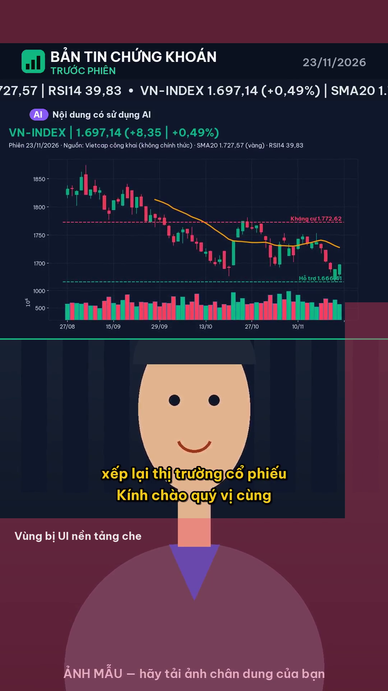
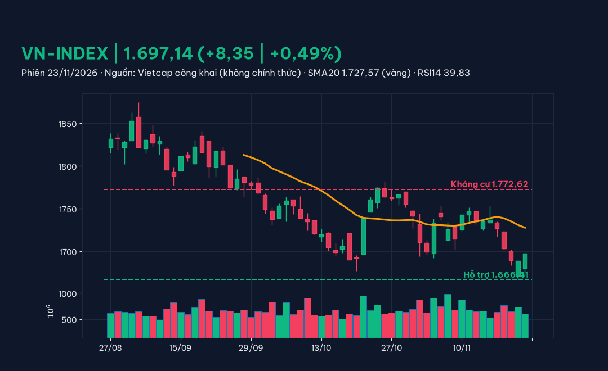
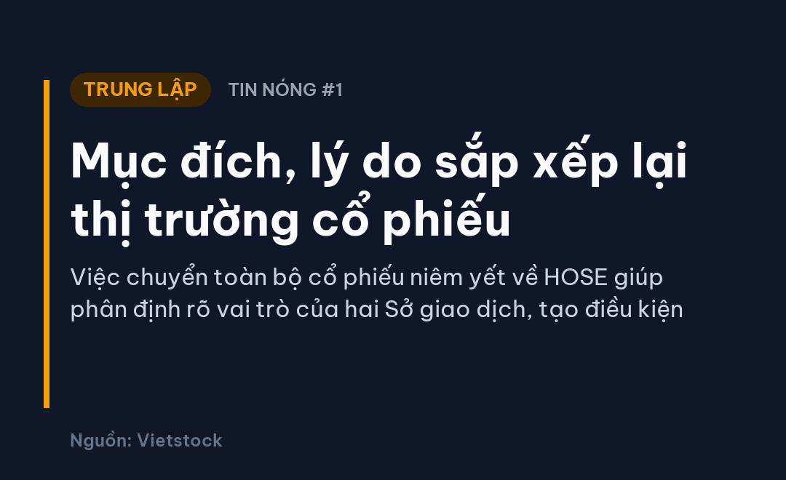

# BÁO CÁO TỔNG KẾT — StockAI Studio (theo Blueprint v3.0)

> Ngày: 23/11/2026 · Repo: https://github.com/luan0217091310-gif/StockAI-Studio (nhánh `main`)
> Tiến độ chi tiết: `docs/PROGRESS.md` · Quyết định & kiểm chứng: `docs/DECISIONS.md`

---

## 1. Kết quả chính

| Hạng mục | Trạng thái |
| :-- | :-- |
| Pipeline 5 bước chạy **end-to-end trên máy thật** | ✅ Ra `final.mp4` 1080×1920, 30 fps, 74 giây, 6,8 MB, đạt kiểm tra ffprobe |
| Dữ liệu thật | ✅ RSS CafeF (50 tin) + Vietstock (20) + VnEconomy (50); VN-Index 60 phiên thật từ Vietcap (1.697,14 ngày 23/11/2026) |
| Giọng đọc thật | ✅ edge-tts `vi-VN-HoaiMyNeural`, có mốc thời gian từng từ → phụ đề khớp |
| Giao diện 5 tab (desktop / trình duyệt) | ✅ Nối API thật, log realtime qua WebSocket |
| Lịch tự động + chạy bù + duyệt bài | ✅ |
| Đăng bài: Telegram thật, FB/YouTube/TikTok (adapter) + dry-run | ✅ (đăng thật cần bạn nhập khóa) |
| Bảo mật (token, Origin, keyring, chống path traversal, che token trong log) | ✅ |
| Test tự động | ✅ **60 test đạt**, `ruff` sạch |
| Web demo online (trang giới thiệu + Studio, `demo/`) | ✅ https://stockai-studio.luan0017091310.workers.dev |

### Ảnh kết quả

| Khung hình video (lớp đỏ = vùng bị UI TikTok/Reels che) | Biểu đồ | Thẻ tin |
| :-: | :-: | :-: |
|  |  |  |

Phụ đề, nhãn AI, ticker và miễn trừ đều nằm **ngoài** vùng bị che (đã có test tự động `test_layout_inside_frame_and_safe`).

---

## 2. Những gì đã làm (đối chiếu Blueprint)

### M0 — Khung dự án ✅
`pyproject.toml` (uv), `config.py`, `layout.py` (tọa độ duy nhất), `models.py` (giữ nguyên tên trường Mục 8), `errors.py`, `secrets.py` (keyring), `db/schema.sql` (đủ 10 bảng), `migrate.py`, `repo.py`, CLI `preflight` / `db migrate`, `docs/DECISIONS.md`, `README.md`, `CLAUDE.md` (Phụ lục A).

### M1 — Thu thập & biểu đồ ✅
- RSS: tải song song, ETag/If-Modified-Since, parse năm 2 chữ số của CafeF, bỏ tin không có ngày, làm sạch HTML, NFC, tóm tắt ≤ 300 ký tự.
- Cửa sổ thời gian: `min(now−48h, 00:00 ngày giao dịch trước)`, tối đa 96h (sáng thứ Hai lấy từ thứ Sáu — có test).
- Lọc chủ đề theo từ khóa, chống trùng (SHA-256 + Jaccard ≥ 0,6), xếp hạng `0,5·độ mới + 0,3·từ khóa + 0,2·số nguồn`, tối đa 20 tin.
- Chuỗi nguồn thị trường: `PublicVci` (thật, không chính thức, chỉ DEMO) → `Cache` → `Synthetic` (có nhãn); thêm `CsvImport` và `SsiFastConnect` (PRODUCTION).
- Chỉ báo: SMA20, **RSI14 Wilder**, hỗ trợ/kháng cự 20 phiên — test so với số tính tay.
- Biểu đồ nến 1080×660, SMA20, đường hỗ trợ/kháng cự, định dạng số Việt Nam, watermark khi dữ liệu minh họa.

### M2 — AI biên tập ✅
- `GeminiProvider` (google-genai, `response_schema`, retry 429/5xx, model dự phòng), `OpenAICompatProvider`, `TemplateFallbackProvider` (5 kiểu hook xoay vòng theo ngày).
- Prompt hệ thống đúng nguyên văn Mục 9.4.
- **Hậu kiểm bằng code**: 160–220 từ, headline ≤ 12 từ, câu miễn trừ ở cuối, khai báo AI, cụm từ cấm, **factcheck số liệu** (đọc được `1.285,40`, `+0,97%`, `450 tỷ`…) và mã cổ phiếu. Lỗi → gọi lại LLM 1 lần kèm danh sách lỗi → vẫn lỗi thì dùng mẫu (test xác nhận số bịa `1.999,99` bị chặn).

### M3 — Giọng đọc & phụ đề ✅
- Chuẩn hóa TTS (`%` → "phần trăm", `+/-` điểm → tăng/giảm, bỏ emoji/ký hiệu, tùy chọn đọc số thành chữ).
- edge-tts `boundary="WordBoundary"` + thử lại 5 lần (dịch vụ đôi khi lỗi ngẫu nhiên); kiểm tra độ dài 45–95 giây, tự chỉnh tốc độ.
- Phụ đề: tối đa 2 dòng, mỗi dòng ≤ 800 px đo bằng font thật, 0,8–3,5 giây/cue, không chồng lấn → `subs.srt` + `subs.ass` đúng style Mục 10.4.
- Nghe thử 5 giây trong app (có cache).

### M4 — Avatar demo & dựng video ✅
- Ảnh mẫu tự vẽ (`is_placeholder=1`), crop 1080×976 (có OpenCV thì căn theo mặt).
- `DemoMotion`: "nhịp thở" 6 giây bằng `zoompan`.
- Dựng 2 giai đoạn: base, thẻ tin, ticker lặp liền mạch, nhãn AI, B-roll có xfade 0,4s (mỗi đoạn 6–8s), ghép cuối bằng filtergraph từ file, sóng âm, phụ đề burn-in, nhãn AI mở rộng 3 giây đầu, miễn trừ 4 giây cuối, loudnorm −14 LUFS, metadata AI (R-LEGAL-2).
- Kiểm tra sau render (kích thước, fps, audio, độ dài, < 48 MB), `thumbnail.jpg`, `safe_zone_check.png`.

### M5 — Backend, Orchestrator & UI ✅
- Orchestrator: khóa job (chỉ 1 job), hủy (kill ffmpeg), **chạy lại từ bước lỗi** (bỏ qua bước đã có artifact đúng checksum trong `manifest.json`), job bị gián đoạn → `FAILED/INTERRUPTED`, chặn máy ngủ khi đang chạy.
- FastAPI đủ endpoint Mục 11 + WebSocket `/ws/events`; token phiên 32 byte, sai/thiếu → 401, Origin lạ → 403, chạy 2 job → 409 (có test).
- UI 5 tab: Bảng điều khiển (4 thẻ, nút chạy/hủy, 5 bước, log realtime, xem video), Nhân vật & giọng (tải ảnh **bắt buộc tick đồng ý**, logo, nhạc nền, chọn provider + ước tính chi phí, nghe thử), Kho nội dung (video, lớp safe-zone, sửa caption có kiểm tra pháp lý, kịch bản, biểu đồ, tin nguồn, phụ đề, log, Duyệt & Đăng), Lịch, Cài đặt.

### M6 — Lịch, Telegram & duyệt ✅
- APScheduler 3.11 múi giờ VN, đồng bộ ngay khi thêm/sửa/xóa, chạy bù lịch lỡ trong 120 phút, thử lại lỗi tạm thời 3 lần/5 phút, `POST_MARKET` không có phiên → `SKIPPED`.
- Mặc định **chờ duyệt**; TikTok luôn cần duyệt.
- Telegram: `sendVideo` (caption ≤ 1024) + `sendMessage` bài đầy đủ (chia ≤ 4096).

### M7 — Tích hợp PRODUCTION ⚠️ (đã viết adapter, chưa kiểm chứng thật)
Đã có: `SsiFastConnectProvider`, `FalAvatarProvider` (+ giới hạn chi phí R-AV-1), `HeyGenProvider` (khung), Facebook Reels (3 bước, giới hạn 30/24h), YouTube (OAuth, `containsSyntheticMedia=true`), TikTok (gửi nháp, `is_aigc=true`), ElevenLabs. Nút "Kiểm tra kết nối" cho từng dịch vụ.
**Chưa thể kiểm chứng** vì cần tài khoản/khóa của bạn — xem mục 5.

### M8 — Đóng gói desktop ✅ (theo cách phù hợp máy có Application Control)
- **`CaiDat.bat`**: cài 1 lần (FFmpeg, uv, thư viện) → tạo biểu tượng **StockAI Studio** ở Desktop + Start Menu → bật tự khởi động cùng Windows.
- Mở app **không có cửa sổ đen** (chạy bằng `pythonw.exe` đã ký của Python gốc + `launcher.pyw`).
- **Icon ở khay hệ thống** (góc phải thanh taskbar): Mở app · Bật/tắt tự khởi động · Thoát. Đóng cửa sổ app thì app vẫn chạy nền để lịch đúng giờ.
- **Chỉ một phiên**: bấm biểu tượng lần nữa chỉ mở lại giao diện, không chạy trùng lịch.
- Không dùng PyInstaller: máy này chặn file `.exe` chưa ký (đã thử: `.venv\Scripts\pythonw.exe` bị chặn) → exe đóng gói cũng sẽ bị chặn. Ghi trong DECISIONS.
- Đã kiểm chứng thật: mở từ lối tắt → chạy job đầy đủ (dữ liệu LIVE, giọng thật) → `final.mp4` 74,1s, chờ duyệt.

### Bổ sung đợt 5 ✅
- **Hybrid avatar**: khớp môi 7s đầu + 8s cuối bằng provider trả phí, đoạn giữa DemoMotion miễn phí, ghép thành 1 avatar.mp4 (tiết kiệm ~80% chi phí). Có test.
- **Gửi bản nháp vào Telegram riêng** khi video chờ duyệt: Cài đặt → "Chat ID nhận bản nháp".

### M9 — Thử nghiệm ❌ không thuộc phạm vi

---

## 3. Cách sử dụng

### 3.1. Mở ứng dụng
- **Lần đầu:** bấm đúp **`CaiDat.bat`** (cài mọi thứ + tạo biểu tượng + tự khởi động cùng Windows).
- **Hằng ngày:** bấm biểu tượng **StockAI Studio** trên Desktop (hoặc Start Menu). Không có cửa sổ đen.
- App có **icon ở khay hệ thống** (góc phải dưới, có thể nằm trong mũi tên ^). Đóng cửa sổ app thì app vẫn chạy nền để chạy lịch; muốn tắt hẳn: chuột phải icon → **Thoát**.
- Cách cũ vẫn dùng được: `MoStockAI.bat` (có cửa sổ console để xem lỗi) hoặc `uv run python app.py --browser`.
- Nếu bấm biểu tượng mà không thấy gì: xem `data\launcher_error.log`.

### 3.2. Tạo video đầu tiên (2–3 phút)
1. Tab **Bảng điều khiển** → chọn loại phiên → bấm **▶ Chạy quy trình ngay**.
2. Xem 5 bước và log chạy realtime. Muốn chạy không cần mạng thì tick **Offline** (khi đó giọng đọc im lặng, dữ liệu dùng file mẫu).
3. Khi xong, video hiện ở khung 9:16 bên phải, trạng thái **Chờ duyệt**.

### 3.3. Đưa ảnh của bạn làm MC
Tab **Nhân vật & giọng** → kéo-thả ảnh chân dung (nên ≥ 720px ngang, mặt nhìn thẳng) → nhập tên → **tick ô đồng ý** → **Tải ảnh lên**. Chọn giọng nam/nữ, tốc độ, bấm **🔊 Nghe thử** → **Lưu cài đặt**. Ảnh/logo/nhạc nền mới được dùng từ lần chạy sau.

### 3.4. Duyệt và đăng
Tab **Kho nội dung** → chọn video → xem video (tick **Lớp safe-zone** để thấy vùng bị che) → sửa tiêu đề/bài đăng (app kiểm tra câu miễn trừ và khai báo AI) → tick nền tảng, chọn quyền riêng tư → **Duyệt & Đăng**.
- Chưa có khóa nền tảng: tick **Chỉ dry-run** → app lưu `publish_preview.json` (bản xem trước nội dung sẽ đăng).
- Dữ liệu minh họa (nhãn vàng "MINH HỌA") **luôn bị chặn đăng** (đúng R-PUB-1).

### 3.5. Đăng thật lên Telegram (miễn phí, nên thử đầu tiên)
1. Trong Telegram, chat với **@BotFather** → `/newbot` → nhận **Bot Token**.
2. Tạo kênh/nhóm, thêm bot làm quản trị. Lấy **Chat ID** (ví dụ `@ten_kenh` hoặc `-100…`).
3. App → **Cài đặt** → dán Bot Token → **Lưu** → điền Telegram Chat ID → **Lưu cài đặt** → **Kiểm tra kết nối**.
4. Duyệt một video **không** phải dữ liệu minh họa → chọn Telegram → **Duyệt & Đăng**.

### 3.6. Dùng Gemini viết kịch bản (thay cho mẫu)
Lấy khóa miễn phí tại https://aistudio.google.com/apikey → **Cài đặt → Gemini API key** → **Lưu** → **Kiểm tra kết nối**. Lưu ý free tier: Google có thể dùng dữ liệu để cải thiện sản phẩm (app chỉ gửi số liệu thị trường và tiêu đề tin).

### 3.7. Lịch tự động
Tab **Lịch tự động**: đã có sẵn 07:30 (trước phiên) và 15:30 (sau phiên), thứ 2–6. Bấm **Tạo lịch thử sau 2 phút** để xem tự chạy. Lịch chỉ chạy khi app đang mở; lỡ lịch trong vòng 120 phút sẽ tự chạy bù khi mở lại.

### 3.8. Các file của mỗi video
Kho nội dung → **Mở thư mục**. Trong đó có `final.mp4`, `thumbnail.jpg`, `subs.srt`, `voice.mp3`, `chart.png`, `script.json`, `manifest.json`, `safe_zone_check.png`…

### 3.9. Web demo
Mở https://stockai-studio.luan0017091310.workers.dev (hoặc `demo/index.html` trên máy). Trang giới thiệu + **Studio** (`app.html`) mô phỏng đủ 5 bước ngay trên trình duyệt: dữ liệu minh họa, kịch bản mẫu qua factcheck thật, video 9:16 dựng bằng canvas, đăng bài dạng dry-run. Bảng lệnh: `Ctrl K`; chuyển tab: phím `1`–`5`. Bản thật là ứng dụng desktop ở trên.

---

## 4. Những điều cần biết trên máy này

- Máy có **Windows Application Control** chặn file `.exe` và một DLL do `uv` tạo. Đã xử lý: chạy bằng `python -m stockai`, và vá import `_multiprocessing` (chi tiết trong DECISIONS).
- Dịch vụ edge-tts đôi khi lỗi ngẫu nhiên → app tự thử lại 5 lần; nếu vẫn lỗi thì video vẫn được dựng nhưng **không có tiếng** (log có cảnh báo vàng). Khi đó bấm chạy lại.
- Nguồn Vietcap là endpoint **không chính thức** (chỉ dùng cho DEMO). Nếu một ngày nó ngừng hoạt động, app tự dùng dữ liệu đã lưu, rồi đến dữ liệu minh họa (bị chặn đăng).
- Avatar DEMO **không khớp môi** (ảnh + chuyển động nhẹ + sóng âm). Muốn khớp môi cần fal.ai/HeyGen (trả phí, chế độ PRODUCTION).

## 5. Việc còn lại / cần bạn quyết định (Mục 17)

| Mã | Việc | Ghi chú |
| :-- | :-- | :-- |
| D1 | Nguồn dữ liệu PRODUCTION (SSI FastConnect) | Adapter đã có; cần tài khoản SSI để kiểm chứng |
| D2–D3 | YouTube / TikTok | Adapter đã có; cần tạo app Google Cloud (OAuth) và app TikTok (audit) |
| D4 | Avatar khớp môi & ngân sách | fal.ai đã có adapter + giới hạn chi phí; HeyGen mới có khung (chưa kiểm chứng API v3) |
| — | Facebook Reels | Cần Page ID + Page Token |
| M8 | Đóng gói | ✅ Xong (lối tắt + khay + tự khởi động). File .exe đơn lẻ không làm vì máy chặn exe chưa ký |
| — | Hybrid avatar | ✅ Xong; cần fal.ai key để chạy thật phần khớp môi |
| — | Bản nháp Telegram riêng | ✅ Xong; cần Bot Token + Chat ID của bạn |

## 6. Cấu trúc dự án

```text
app.py                 cửa sổ desktop + server (fallback trình duyệt)
CaiDat.bat             cài 1 lần + tạo biểu tượng Desktop/Start Menu + tự khởi động
launcher.pyw           khởi động không console (lối tắt trỏ vào đây)
MoStockAI.bat          mở app kèm console (xem lỗi)
stockai/               mã nguồn (config, layout, models, db, server, pipeline, providers, analysis, text, render, scheduler, cli)
ui/                    giao diện (HTML + JS + CSS, chạy offline)
assets/fonts/          Be Vietnam Pro (OFL)
tests/                 60 test + fixture (RSS tự tạo, OHLCV 60 phiên, audio 8s)
demo/                  web demo: index.html (giới thiệu) + app.html (Studio) + assets/engine.js
docs/                  BLUEPRINT, DECISIONS, PROGRESS, ảnh minh họa
```

## 7. Lệnh nghiệm thu đã chạy

```text
uv run python -m stockai preflight      → Môi trường SẴN SÀNG (FFmpeg 9.1 + 7 filter + libx264/aac, font, SQLite 10 bảng, keyring)
uv run ruff check .                     → All checks passed!
uv run python -m pytest -q              → 60 passed
uv run python -m stockai run --mode demo --no-publish   → COMPLETED, final.mp4 đạt ffprobe
API: thiếu token → 401 · Origin lạ → 403 · chạy job thứ 2 → 409 · duyệt dry-run 4 nền tảng → DRY_RUN ×4
```
