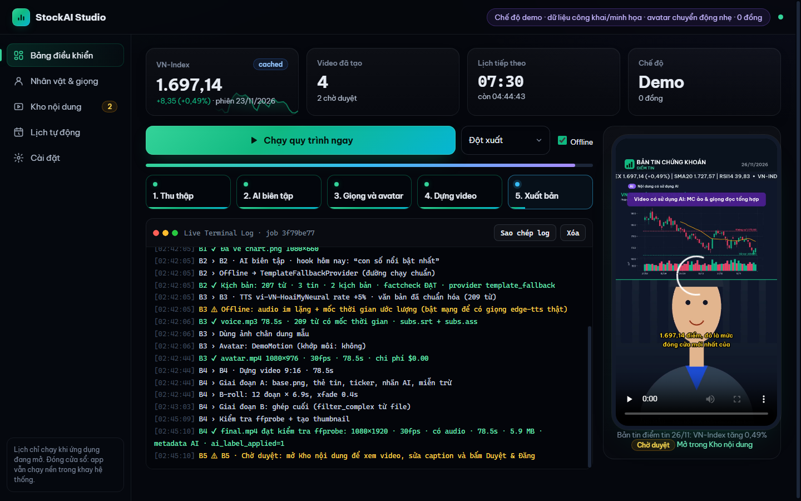

# StockAI Studio

Ứng dụng desktop tự động tạo **bản tin chứng khoán video 9:16** có MC ảo nói tiếng Việt, theo đặc tả `docs/BLUEPRINT.md` (v3.0).

Quy trình 5 bước: **Thu thập → AI biên tập → Giọng & Avatar → Dựng video → Xuất bản (chờ duyệt)**.

**Web demo (chạy ngay trên trình duyệt, không cần cài):** https://stockai-studio.luan0017091310.workers.dev — trang giới thiệu + Studio mô phỏng đủ 5 bước.



## Cài đặt (Windows)

```powershell
winget install Gyan.FFmpeg
winget install astral-sh.uv
# mở cửa sổ PowerShell MỚI, vào thư mục dự án:
uv sync
```

macOS: `brew install ffmpeg uv` rồi `uv sync`.

## Chạy

| Việc | Lệnh |
| :-- | :-- |
| Cài 1 lần + tạo biểu tượng Desktop | bấm đúp `CaiDat.bat` (hoặc `uv run python -m stockai install --autostart`) |
| Mở app (cửa sổ desktop) | bấm đúp `MoStockAI.bat` hoặc `uv run python app.py` |
| Mở app trong trình duyệt | `uv run python app.py --browser` |
| Kiểm tra môi trường | `uv run python -m stockai preflight` |
| Chạy pipeline 1 lần (có mạng) | `uv run python -m stockai run --mode demo --no-publish` |
| Chạy offline (không mạng) | `uv run python -m stockai run --mode demo --offline --no-publish` |
| Chỉ chạy tới 1 bước | `uv run python -m stockai run --step collect --offline` (`collect / edit / voice / render`) |
| Video mẫu 8 giây | `uv run python -m stockai render-sample` |
| Test | `uv run python -m pytest -q` |
| Xem web demo trên máy | `uv run python -m http.server 8899 -d demo` rồi mở http://127.0.0.1:8899 |
| Deploy web demo | push nhánh `main` (Cloudflare Workers Builds chạy `npx wrangler deploy` theo `wrangler.jsonc`) |

> Dùng `python -m stockai` thay vì `stockai`: một số máy Windows bật Application Control chặn file `.exe` do uv tạo.

Dữ liệu (DB, video, log) nằm trong thư mục người dùng (`%LOCALAPPDATA%\StockAI\StockAI Studio`) hoặc `STOCKAI_DATA_DIR` (file `.bat` dùng `./data`).

Hướng dẫn sử dụng chi tiết và tổng kết: **[BAO_CAO.md](BAO_CAO.md)**.
